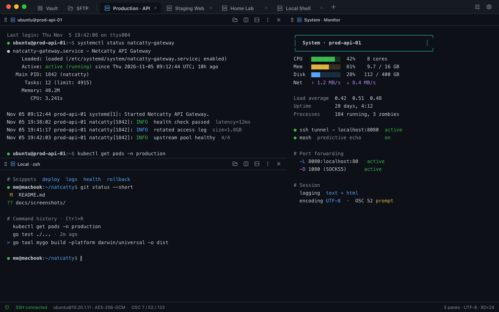
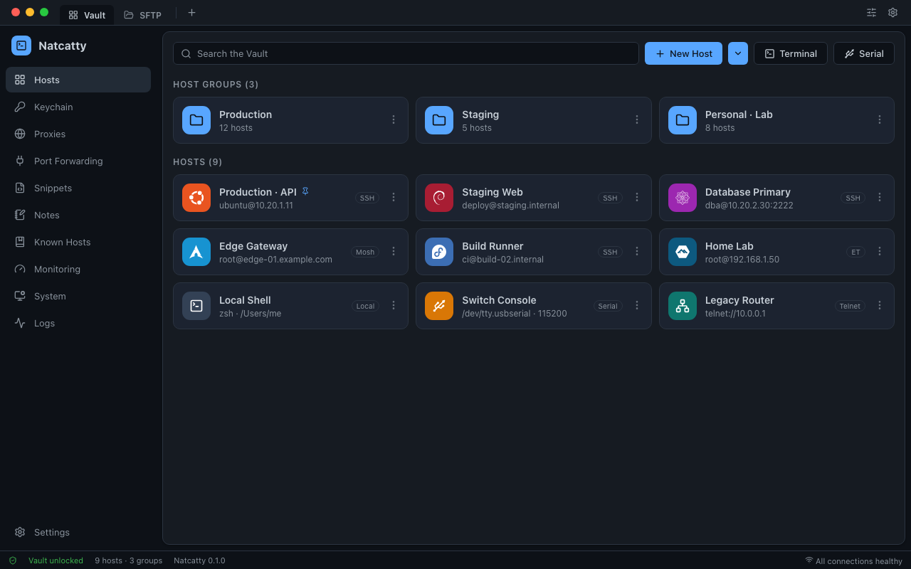
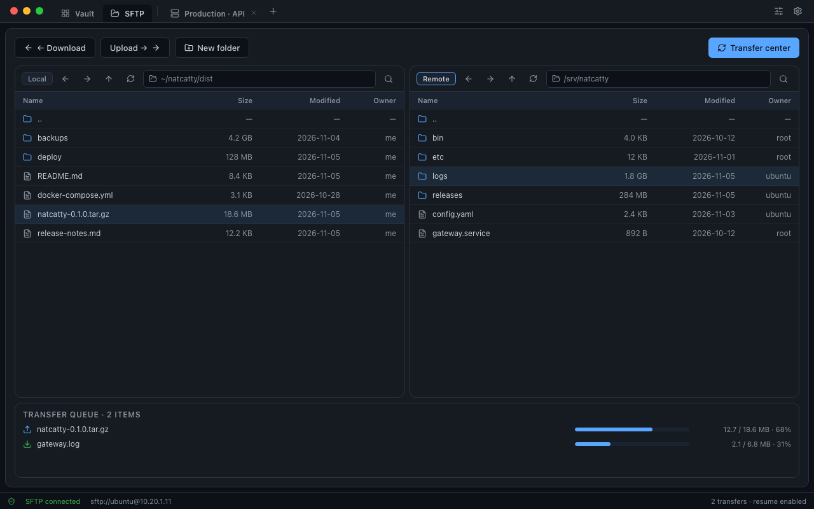
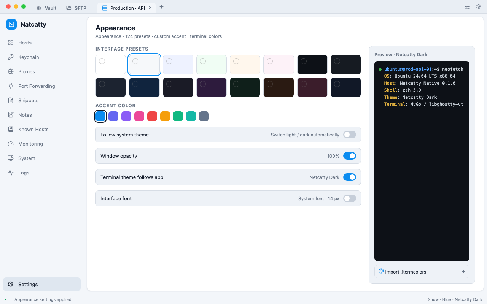
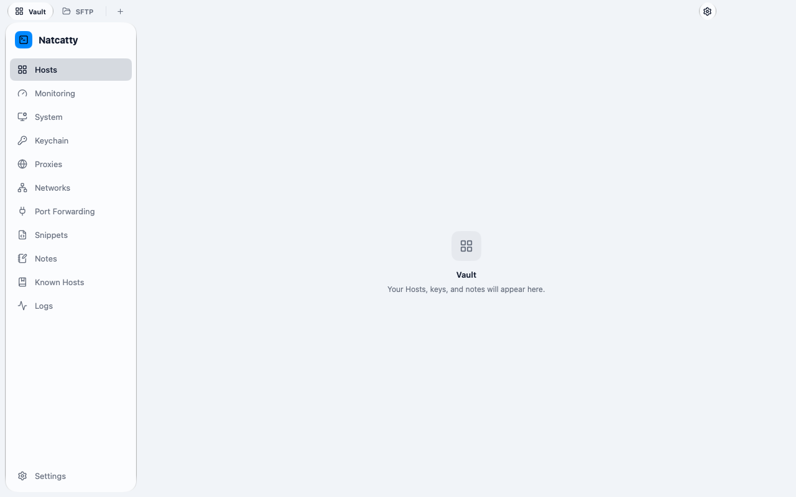
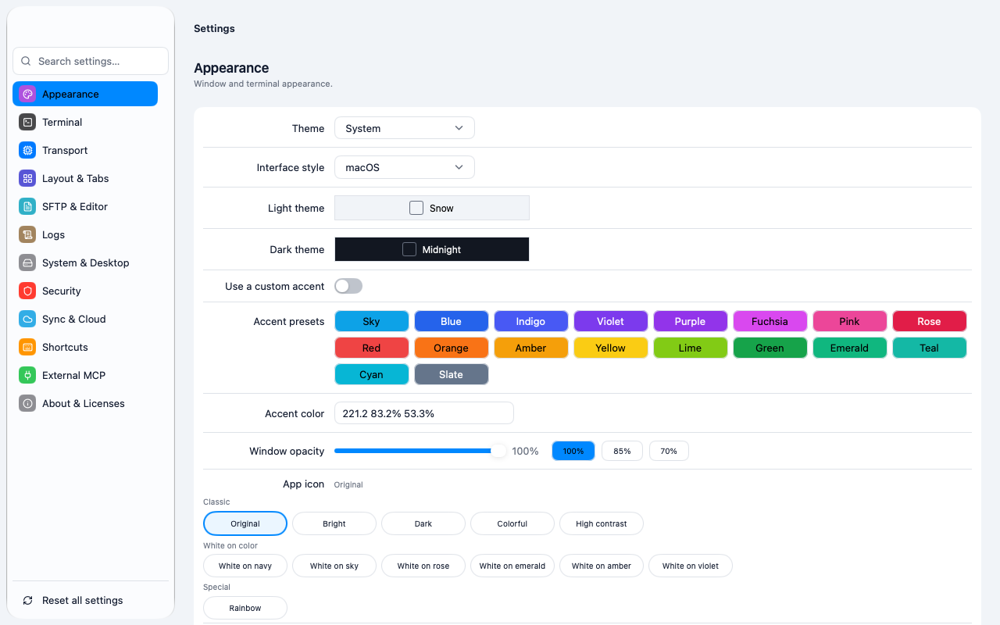

<p align="center">
  
</p>

<h1 align="center">Netcatty Native</h1>

<p align="center">
  <b>A native terminal and connection manager written in Go</b><br>
  SSH · Mosh · EternalTerminal · Telnet · Serial · Local Shell · SFTP / SCP
</p>

<p align="center">
  
  
  
  
  
  
</p>

<p align="center">
  <a href="README.md"><b>English</b></a> · <a href="README.zh-CN.md">简体中文</a>
</p>

<p align="center">
  <a href="#screenshots">Screenshots</a> ·
  <a href="#features">Features</a> ·
  <a href="#protocols">Protocols</a> ·
  <a href="#download--install">Download &amp; Install</a> ·
  <a href="#build-from-source">Build from Source</a> ·
  <a href="#nix">Nix</a> ·
  <a href="#project-status">Project Status</a> ·
  <a href="#license">License</a>
</p>

---

<p align="center">
  
  <br>
  <sub>Multiple tabs and recursive split panes — a remote session, a local shell, and live monitoring side by side</sub>
</p>

## Screenshots

<table>
  <tr>
    <td align="center" width="50%">
      <a href="docs/screenshots/01-vault-hosts.png"></a>
      <br><b>Vault · Hosts and Host Groups</b><br>
      <sub>Grouping, distribution avatars, pinned hosts, and search</sub>
    </td>
    <td align="center" width="50%">
      <a href="docs/screenshots/03-sftp-transfer.png"></a>
      <br><b>SFTP · Dual panes and transfer queue</b><br>
      <sub>Local / remote side by side, resumable transfers, progress</sub>
    </td>
  </tr>
  <tr>
    <td align="center" colspan="2">
      <a href="docs/screenshots/04-appearance.png"></a>
      <br><b>Appearance · Light theme</b><br>
      <sub>124 interface presets, accent colors, terminal color schemes, and <code>.itermcolors</code> import</sub>
    </td>
  </tr>
  <tr>
    <td align="center" width="50%">
      <a href="docs/screenshots/05-macos-home.png"></a>
      <br><b>Interface style · macOS</b><br>
      <sub>Floating glass sidebar and capsule tabs; switch styles in Settings › Appearance</sub>
    </td>
    <td align="center" width="50%">
      <a href="docs/screenshots/07-macos-settings.png"></a>
      <br><b>Settings · macOS style</b><br>
      <sub>Colored area tiles and inset grouped forms</sub>
    </td>
  </tr>
</table>

---

## Features

Netcatty Native is a **ground-up native rewrite** of [binaricat/Netcatty](https://github.com/binaricat/Netcatty), built with Go and [MyGo](https://github.com/egoist/mygo). The interface uses immediate-mode native widgets and the terminal is powered by libghostty-vt. **No Node.js, Chromium renderer, or plugin runtime is shipped.**

<table>
  <tr>
    <th width="33%" align="left">🖥️ Terminal workspace</th>
    <th width="33%" align="left">🔐 Connections &amp; credentials</th>
    <th width="33%" align="left">☁️ Data, sync &amp; automation</th>
  </tr>
  <tr valign="top">
    <td>
      • Multiple tabs with recursive split panes<br>
      • Workspace save / restore, detached windows<br>
      • Session Hibernate / Resume, read-only Observer snapshots<br>
      • Session logging (raw / text / HTML), command tracking, activity indicators<br>
      • OSC 7 / 52 / 99 / 133, ZMODEM / YMODEM detection gating<br>
      • UTF-8 plus GB18030 / Shift_JIS / ISO-8859-1 switching<br>
      • Protected multiline paste, path drag-and-drop with shell-correct quoting<br>
      • Command history, autocomplete, Quick Switcher, and command palette
    </td>
    <td>
      • SSH (<code>x/crypto/ssh</code>), Mosh, EternalTerminal<br>
      • Telnet, Serial, local PTY / Shell<br>
      • Jump hosts, ProxyCommand, HTTP CONNECT, SOCKS5<br>
      • Public key / certificate / password / keyboard-interactive MFA, FIDO security keys<br>
      • tmux auto-attach, X11 forwarding, Known Hosts<br>
      • Local / remote / dynamic (SOCKS5) port forwarding<br>
      • Encrypted Vault: Hosts, Host Groups, SSH Keys, Identities, Snippets, Notes<br>
      • Master-password App Lock, OS credential store, field-level secret key hierarchy
    </td>
    <td>
      • SFTP / SCP dual-pane browser with pause / cancel / resume / reattach<br>
      • Directory transfers, overwrite &amp; restart policies, remote file editor<br>
      • Cloud sync: GitHub Gist, Google Drive, OneDrive, WebDAV, S3<br>
      • Encrypted sync envelope (AES-256-GCM / PBKDF2), three-way merge, conflict backups<br>
      • Import / export, encrypted Local Backups, protective backup before Restore<br>
      • External MCP stdio server and tool catalog (with permission prompts)<br>
      • Monitoring panels and System Manager (processes / ports / services / tmux / Docker / GPU)<br>
      • 5 locales, 124 interface presets, 198 terminal color schemes
    </td>
  </tr>
</table>

<details>
<summary><b>Scope · what is not supported</b></summary>

<br>

To describe the feature set accurately, the following are **explicitly out of scope** in the current version: a plugin runtime and plugin sync providers, a built-in AI assistant, Electron data migration, custom CSS, terminal content search / selection export, inline images, a second live terminal view, a terminal accessibility tree, per-Host cookie partitioning, SSH compression and several legacy algorithms, and Windows arm64. See [`docs/parity/limitations.md`](docs/parity/limitations.md) for details.

</details>

## Documentation

- [Network Providers](docs/network-providers.md): in-process Tailscale Net and
  WireGuard Net, supported transports, capability limits, validation status,
  and the opt-in real-network tests.
- [Packaging](docs/packaging.md): release artifacts and platform requirements.

---

## Protocols

| Protocol | Notes |
| --- | --- |
| **SSH** | The sole SSH transport is built on `golang.org/x/crypto/ssh`; supports agent / public key / certificate / password / keyboard-interactive MFA / FIDO security keys (via system OpenSSH), jump hosts, X11 forwarding, and tmux auto-attach |
| **Mosh** | Bootstraps over SSH, then hands off to Mosh; always uses the built-in pure-Go in-process client, with predictive local echo |
| **EternalTerminal (ET)** | Always uses the built-in pure-Go in-process client; no external `et` binary is launched |
| **Telnet** | Lazy IAC negotiation and raw-TCP passthrough |
| **Serial** | Port enumeration and baud / parity settings (POSIX termios / Windows DCB) |
| **Local** | Local PTY running the system default shell |
| **SFTP / SCP** | File transfer with automatic fallback, sudo SFTP, single-channel Hosts, and a custom SCP backend |

---

## Build from Source

Build the artifact for the platform you can package on (the DMG needs macOS; NSIS needs Windows):

```sh
go tool mygo build -platform windows/amd64 -o dist
go tool mygo build -platform linux/amd64,linux/arm64 -o dist
go tool mygo build -platform darwin/universal -o dist    # macOS runner needed for the DMG
```
---

## Nix

The flake supports `aarch64-darwin`, `aarch64-linux`, and `x86_64-linux`:

```sh
nix develop
nix build .#natcatty
```

The Nix package keeps `mygo.json`, `CHANGELOG.md`, and the `resources/` directory beside the executable so bundled runtime resources can be resolved from a Nix store path. On NixOS or nix-darwin, import the matching module and enable the program:

```nix
{
  # In a NixOS module, with `natcatty` bound to the flake input:
  imports = [ natcatty.nixosModules.default ];
  programs.natcatty.enable = true;

  # nix-darwin uses `natcatty.darwinModules.default` instead.
}
```

---

## Project Status

> [!WARNING]
> **This repository is generated and maintained almost entirely by AI, with almost no human involvement.**
>
> Code, commits, documentation, and releases may not have been reviewed by a human. Functionality, stability, and security are **not guaranteed** in any way. Bugs, incomplete implementations, breaking changes — or a build that simply does not run — are all possible. **Do not** use this in production or for anything important. Any consequences of using this repository are the user's own responsibility.
>
> For a stable and reliable version, use the upstream project [binaricat/Netcatty](https://github.com/binaricat/Netcatty).


---

## License

Netcatty Native is a modified version of [Netcatty](https://github.com/binaricat/Netcatty) and is distributed under the **GNU General Public License, version 3 or later** (`GPL-3.0-or-later`).

---

<p align="center">
  <sub>Netcatty Native · in-app name <b>Natcatty</b> · 0.1.0 · built with Go + MyGo</sub>
</p>
