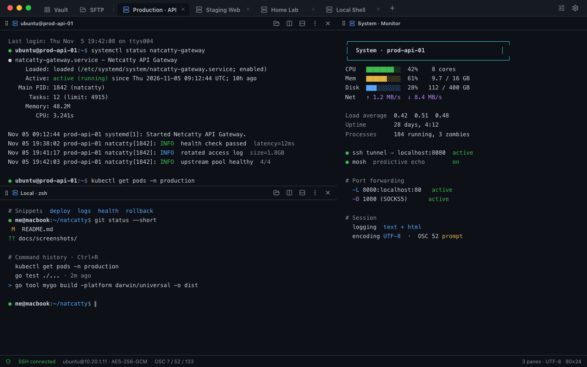
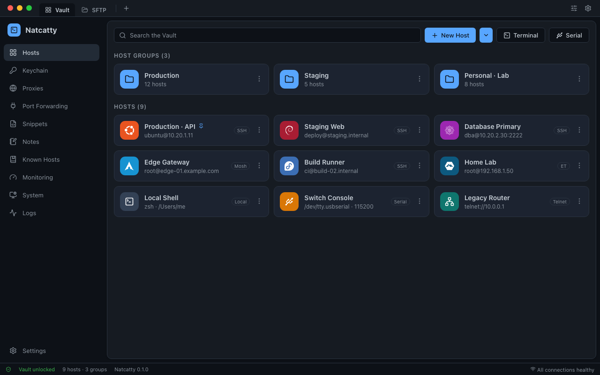
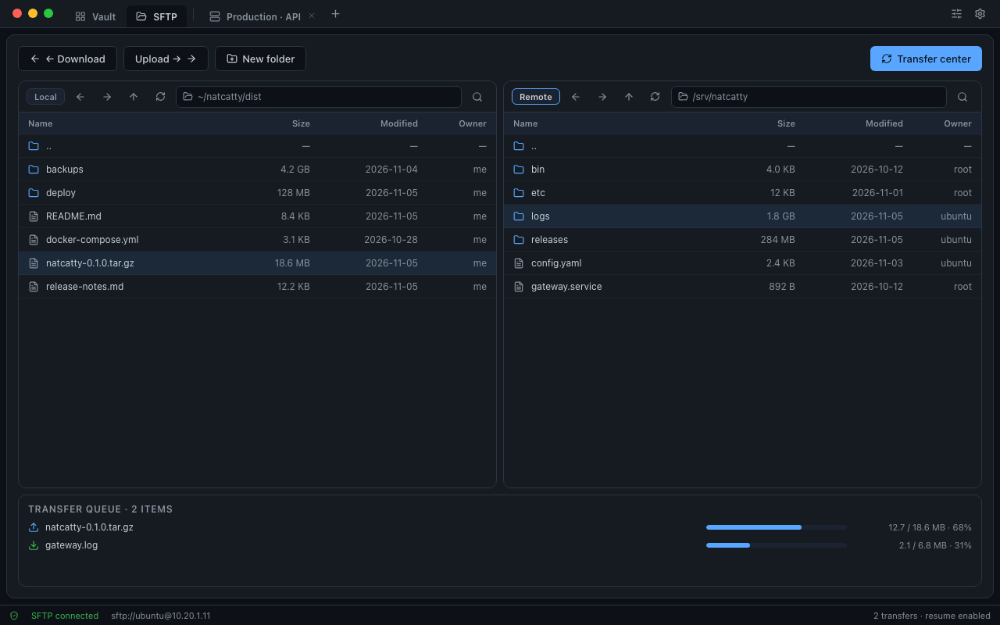
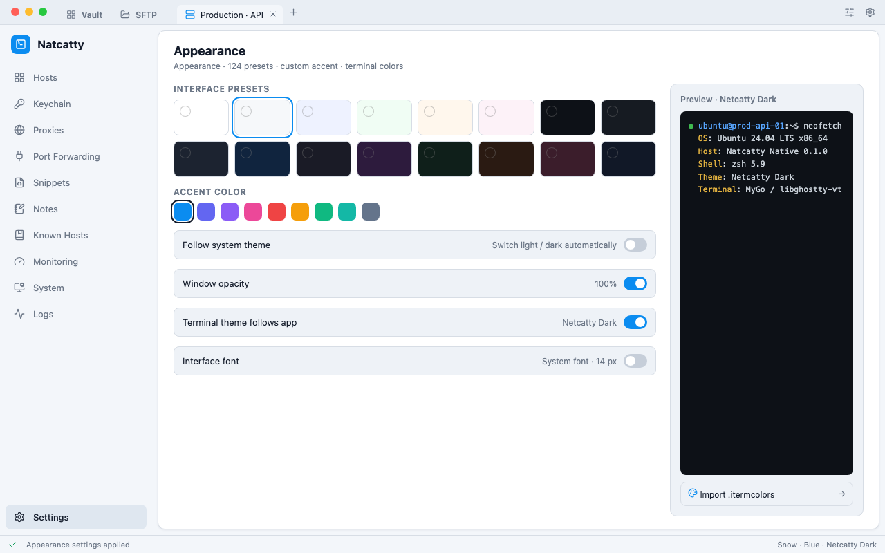

<p align="center">
  
</p>

<h1 align="center">Netcatty Native</h1>

<p align="center">
  <b>一个用 Go 编写的原生终端与连接管理器</b><br>
  SSH · Mosh · EternalTerminal · Telnet · Serial · Local Shell · SFTP / SCP
</p>

<p align="center">
  
  
  
  
  
  
</p>

<p align="center">
  <a href="README.md">English</a> · <a href="README.zh-CN.md"><b>简体中文</b></a>
</p>

<p align="center">
  <a href="#界面一览">界面一览</a> ·
  <a href="#特性与能力">特性与能力</a> ·
  <a href="#连接协议">连接协议</a> ·
  <a href="#从源码构建">从源码构建</a> ·
  <a href="#nix">Nix</a> ·
  <a href="#项目状态">项目状态</a> ·
  <a href="#许可证">许可证</a>
</p>

---

<p align="center">
  
  <br>
  <sub>多标签页与递归分屏 —— 远程会话、本地 Shell 与实时监控并排显示</sub>
</p>

> [!NOTE]
> 以下界面图为**基于真实 UI 布局绘制的示意图**，用于展示界面结构。其中的主机、日志、文件列表与传输进度均为示例数据，并非真实运行截图。

## 界面一览

<table>
  <tr>
    <td align="center" width="50%">
      <a href="docs/screenshots/01-vault-hosts.png"></a>
      <br><b>Vault · 主机与主机组</b><br>
      <sub>分组管理、发行版头像、置顶与搜索</sub>
    </td>
    <td align="center" width="50%">
      <a href="docs/screenshots/03-sftp-transfer.png"></a>
      <br><b>SFTP · 双窗格与传输队列</b><br>
      <sub>本地 / 远程并排、断点续传、进度管理</sub>
    </td>
  </tr>
  <tr>
    <td align="center" colspan="2">
      <a href="docs/screenshots/04-appearance.png"></a>
      <br><b>外观 · 浅色主题</b><br>
      <sub>124 套界面预设、强调色、终端配色与 <code>.itermcolors</code> 导入</sub>
    </td>
  </tr>
</table>

---

## 特性与能力

Netcatty Native 是 [binaricat/Netcatty](https://github.com/binaricat/Netcatty) 的**彻底原生重写版**，使用 Go 与 [MyGo](https://github.com/egoist/mygo) 构建。界面采用即时模式原生控件，终端由 libghostty-vt 驱动。**不附带 Node.js、Chromium 渲染进程或插件运行时。**

<table>
  <tr>
    <th width="33%" align="left">🖥️ 终端工作台</th>
    <th width="33%" align="left">🔐 连接与凭证</th>
    <th width="33%" align="left">☁️ 数据、同步与自动化</th>
  </tr>
  <tr valign="top">
    <td>
      • 多标签页 + 递归分屏窗格<br>
      • 工作区保存 / 恢复、窗口分离<br>
      • 会话休眠（Hibernate）/ 恢复（Resume）、只读 Observer 快照<br>
      • 会话日志（raw / text / HTML）、命令追踪、活动指示<br>
      • OSC 7 / 52 / 99 / 133、ZMODEM / YMODEM 检测门控<br>
      • UTF-8 及 GB18030 / Shift_JIS / ISO-8859-1 切换<br>
      • 受保护的多行粘贴、路径拖拽与 Shell 正确转义<br>
      • 命令历史、自动补全、快速切换器与命令面板
    </td>
    <td>
      • SSH（<code>x/crypto/ssh</code>）、Mosh、EternalTerminal<br>
      • Telnet、串口、本地 PTY / Shell<br>
      • 跳板机、ProxyCommand、HTTP CONNECT、SOCKS5<br>
      • 公钥 / 证书 / 密码 / 键盘交互 MFA、FIDO 安全密钥<br>
      • tmux 自动附着、X11 转发、Known Hosts<br>
      • 本地 / 远程 / 动态（SOCKS5）端口转发<br>
      • 加密 Vault：主机、主机组、SSH 密钥、身份、代码片段、笔记<br>
      • 主密码 App Lock、系统密钥库、字段级密钥层级
    </td>
    <td>
      • SFTP / SCP 双窗格浏览器，支持暂停 / 取消 / 断点续传 / 重连续传<br>
      • 目录传输、覆盖与重启策略、远程文件编辑器<br>
      • 云同步：GitHub Gist、Google Drive、OneDrive、WebDAV、S3<br>
      • 加密同步信封（AES-256-GCM / PBKDF2）、三路合并、冲突备份<br>
      • 导入 / 导出、加密本地备份、恢复前的保护性备份<br>
      • 外部 MCP stdio 服务与工具目录（带权限确认）<br>
      • 监控面板与系统管理器（进程 / 端口 / 服务 / tmux / Docker / GPU）<br>
      • 5 种语言、124 套界面预设、198 套终端配色
    </td>
  </tr>
</table>

<details>
<summary><b>边界说明 · 当前不支持</b></summary>

<br>

为准确描述能力范围，以下功能在当前版本中**明确不受支持**：插件运行时与插件同步源、内置 AI 助手、Electron 数据迁移、自定义 CSS、终端内容搜索 / 选区导出、行内图片、第二个实时终端视图、终端无障碍树、按主机隔离 Cookie、SSH 压缩及部分传统算法，以及 Windows arm64。详见 [`docs/parity/limitations.md`](docs/parity/limitations.md)。

</details>

---

## 连接协议

| 协议 | 说明 |
| --- | --- |
| **SSH** | 唯一的 SSH 传输基于 `golang.org/x/crypto/ssh`；支持 agent / 公钥 / 证书 / 密码 / 键盘交互 MFA / FIDO 安全密钥（经系统 OpenSSH）、跳板机、X11 转发与 tmux 自动附着 |
| **Mosh** | 经 SSH 引导后切换至 Mosh；始终使用内置的纯 Go 进程内客户端，支持预测式本地回显 |
| **EternalTerminal (ET)** | 始终使用内置的纯 Go 进程内客户端，不启动外部 `et` 二进制 |
| **Telnet** | 惰性 IAC 协商与原始 TCP 透传 |
| **Serial** | 端口枚举与波特率 / 校验位设置（POSIX termios / Windows DCB） |
| **Local** | 运行系统默认 Shell 的本地 PTY |
| **SFTP / SCP** | 文件传输，支持自动降级、sudo SFTP、单通道主机与自定义 SCP 后端 |

---

## 从源码构建

在可打包的平台上构建对应产物（DMG 需 macOS；NSIS 需 Windows）：

```sh
go tool mygo build -platform windows/amd64 -o dist
go tool mygo build -platform linux/amd64,linux/arm64 -o dist
go tool mygo build -platform darwin/universal -o dist    # 生成 DMG 需要 macOS
```
---

## Nix

flake 支持 `aarch64-darwin`、`aarch64-linux` 与 `x86_64-linux`：

```sh
nix develop
nix build .#natcatty
```

Nix 包会把 `mygo.json`、`CHANGELOG.md` 与 `resources/` 目录放在可执行文件旁，以便从 Nix store 路径解析打包的运行时资源。在 NixOS 或 nix-darwin 上引入对应模块并启用：

```nix
{
  # 在 NixOS 模块中，假设 flake input 绑定为 natcatty：
  imports = [ natcatty.nixosModules.default ];
  programs.natcatty.enable = true;

  # nix-darwin 改用 natcatty.darwinModules.default
}
```

---

## 项目状态

> [!WARNING]
> **本仓库几乎完全由 AI 生成与维护，基本没有人工参与。**
>
> 代码、提交、文档与发布均可能未经人工审查。功能、稳定性与安全性**不作任何保证**。缺陷、未完成实现、破坏性变更，甚至根本无法构建都有可能出现。**请勿**用于生产环境或任何重要用途，使用后果由使用者自行承担。
>
> 需要稳定可靠的版本，请使用上游项目 [binaricat/Netcatty](https://github.com/binaricat/Netcatty)。


---

## 许可证

Netcatty Native 是 [Netcatty](https://github.com/binaricat/Netcatty) 的修改版本，按 **GNU General Public License, version 3 or later**（`GPL-3.0-or-later`）分发。

---

<p align="center">
  <sub>Netcatty Native · 应用内名称 <b>Natcatty</b> · 0.1.0 · 由 Go + MyGo 构建</sub>
</p>
